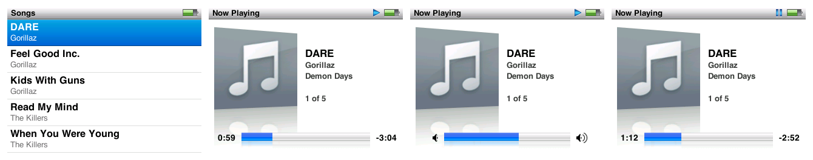

# Two clickwheel iPods in QEMU, booting Apple's real firmware

This fork of [QEMU-iOS](https://github.com/devos50/qemu-ios) adds **two machines**
that emulate clickwheel iPods and **boot real software dumped from the physical
devices**, with no boot ROM and without patching a single firmware instruction.

| Machine | SoC | What it boots |
|---|---|---|
| **`iPod-Classic`** | Samsung S5L8702 | **Apple's retailOS**: RTXC kernel, disk, fonts, full clickwheel navigation, and **the music player — Now Playing screen and audio out of the guest's own I2S**. Firmware 1.1.2, and [2.0.5 / RepriseOS](#firmware-205-and-repriseos), where the player works in full |
| **`iPod-Video`** | PortalPlayer PP5022C | **Rockbox** up to its menu, navigable, and **Apple's retailOS**: language screen → main menu → submenus → back |

Neither machine emulates Apple's boot ROM. The *hardware* the firmware touches is
modelled, and what that ROM left in memory is reproduced by hand. Full detail in
[`wiki/`](wiki/).

> **You need your own iPod.** This repository ships **no firmware**. Every dumped
> artefact lives in `assets/`, which is kept out of git on purpose: it is not ours to
> redistribute. Without your own dump there is nothing to boot. Both dump chains are
> documented below.


*Apple's own Now Playing screen, in the emulator: album art, track, artist, album,
track N of M and the progress bar. Audio is carried by the firmware's own render pump,
DMA and I2S.*

---

## The music player

The player was the last and longest wall. It used to come up half-drawn and silent, and
drop back to the song list after 18 seconds.


Four separate bugs stood between those two screenshots. The third one is the one worth
seeing.

### The compositor was covering the player

**The player screen was being drawn the whole time.** Dumping the display pipe's
surfaces with the player open, layer 0 holds the entire player UI — title bar, artist,
album, track N of M, progress bar — and layer 1 holds the album art, opaque and full
screen. The compositor drew back-to-front starting at layer 0, so the art erased the
player and left exactly the blank right-hand side that made the screen look half-drawn.


Same frame, same data on both sides. The only difference is the order the two layers
are composited in.

The other half of the same bug: the model was **discarding the layer's alpha channel**.
It really has one — the alpha byte takes 246 distinct values across the surface and the
layer is 82% transparent.


Compositing front-to-back with source-over fixes it, and it still explains the
language-screen wipe that the original back-to-front Z order had been inferred from:
that inference assumed opaque layers, which is where it went wrong.

### The other three

1. **The render pump gave up after exactly 8 calls, every run.** The function that hands
   out audio buffers guards on a halfword in internal RAM, and watching that address
   across a whole three-minute run — boot included — showed that **no CPU access ever
   writes it**. The audio engine keeps state in IRAM that the firmware reads back, and
   the model was a register file that never wrote memory. What made it implementable
   rather than guesswork: the geometry is not a hidden hardware constant — the engine
   publishes it and the firmware reads it back to derive the buffer address and size.
   Render pump went from 8 activations to 1343, at ~20/s, which is exactly the slot
   cadence at 44.1 kHz.

2. **The copy direction was backwards.** The pump acquires a codec buffer and copies
   *into* it from the IRAM slot. Filling the codec buffers meant writing to the far end
   of that memcpy, where the firmware overwrote it immediately.

3. **"Low Battery — Connect to Power".** The battery ADC was being read correctly the
   whole time; what was missing was telling the firmware it was plugged in.


Audio captured off the emulator's I2S with the host shortcut disabled, so the only
possible path is the guest's own render pump, DMA and I2S. 77-80% non-silent samples
once playback is going.

**Still broken:** elapsed time stays at 0:00, pause stops the audio but will not resume,
and switching tracks gives a burst and then silence. The MP3 decode itself is done
host-side, the way an emulator handles an undocumented on-chip codec; everything else —
track selection, transport, render pump, DMA, I2S — runs on the firmware.

That paragraph is firmware 1.1.2 with the flags of its day. On firmware 2.0.5 all
three work, and the audio is carried by the firmware end to end — see
[Firmware 2.0.5 and RepriseOS](#firmware-205-and-repriseos).

Full write-up: [`wiki/20-classic6g-reproductor.md`](wiki/20-classic6g-reproductor.md)
(how it was fixed) and [`wiki/19-classic6g-dsp-hle.md`](wiki/19-classic6g-dsp-hle.md)
(the investigation, including the ~16 hypotheses that had to be retracted).

---

## Navigation

| | | |
|---|---|---|
|  |  |  |
| Language screen | Main menu | Music menu |


The library reads from a real `iTunesDB` on a FAT32 volume built by the tools in
`tools/ipod_classic/`.

---

## Building

Built under WSL against a tree living on Windows. **The binary is a Linux ELF: it only
runs under WSL.** Full detail and three environment traps (CRLF, git symlinks,
`--disable-werror`) in [`wiki/05-build-notes.md`](wiki/05-build-notes.md).

```bash
# Configure (once)
mkdir -p build && cd build
../configure --enable-sdl --disable-cocoa --target-list=arm-softmmu \
             --disable-capstone --disable-slirp \
             --extra-cflags=-I/usr/include/openssl --extra-ldflags=-lcrypto \
             --disable-werror --enable-pie

# Build
ninja qemu-system-arm
```

Dependencies on Ubuntu 24.04:

```bash
sudo apt install -y libsdl2-dev libssl-dev libglib2.0-dev libpixman-1-dev \
                    ninja-build python3-venv dosfstools mtools
```

A cold build takes about **16 minutes**. A no-op `ninja` takes ~20 s warm, but can take
**6 minutes** the first time after touching files from Windows — that is the 9p cache
on `/mnt/c`, not a broken build.

### macOS (Apple Silicon)

```bash
brew install glib ninja pixman pkg-config sdl2 openssl@3 ffmpeg dosfstools mtools libplist

# QEMU 8.2's configure needs distlib and does not run on a recent Homebrew Python.
python3.11 -m venv .cache/hostpy && .cache/hostpy/bin/pip install distlib setuptools wheel

mkdir -p build && cd build
../configure --python=$PWD/../.cache/hostpy/bin/python3 --enable-sdl \
             --target-list=arm-softmmu --disable-capstone --disable-pie --disable-slirp \
             --disable-werror \
             --extra-cflags=-I/opt/homebrew/opt/openssl@3/include \
             --extra-ldflags='-L/opt/homebrew/opt/openssl@3/lib -lcrypto'
ninja qemu-system-arm
```

The binary is native; nothing here needs WSL. A cold build took about two minutes on
an M-series Mac.

---

## Running the iPod Classic 6G

You need the **decrypted** `osos` (see [the chain](#dumping-from-a-physical-ipod-classic-6g))
and a disk image built from the `.ipsw` firmware partition.

```bash
# The disk. The FAT32 volume is deliberately EMPTY: the fonts live in the
# FIRMWARE partition, not here.
truncate -s 64M ~/6g/fat32.img && mkfs.vfat -F 32 -n IPOD ~/6g/fat32.img
python3 tools/ipod_classic/mkdisk6g4k.py ~/6g/E.img \
        assets/extracted/Firmware-24.9.1.2 ~/6g/fat32.img

# Boot
cd build && ./qemu-system-arm -M iPod-Classic \
    -kernel ../assets/classic6g/osos_decrypted.bin -serial null \
    -drive if=ide,format=raw,file=$HOME/6g/E.img -snapshot
```

- **Without `-drive` there is no picture**, and that is the guest's doing, not the
  model's: the UI dies looking for fonts, which live in the firmware's `rsrc`
  partition. It enters a crash-and-reboot cycle.
- `-serial null` keeps the console clean. **The firmware talks on stderr**
  (semihosting) — never discard it.

### Running the music player

The player needs several environment flags, each documented in
[`wiki/20-classic6g-reproductor.md`](wiki/20-classic6g-reproductor.md). They are behind
flags because each has measured trade-offs and none is settled enough to impose:

```sh
IRAMSPILL=0x10000 SHA1_ZERO=1 SM1_IRQ=1 \
SM1_SLOTS=1 SM1_NSLOTS=2 SM1_DECODE=1 SM1_FEED_OFF=1 \
DISP_ALPHA=1 PMUCHARGER=adapter \
HLE_AUDIO_DATAPATH=1 HLE_AUDIO_SUSTAIN=1 HLE_AUDIO_DISK=<disk image> \
./qemu-system-arm -M iPod-Classic ... -display sdl
```

`SM1_NSLOTS=2` is not cosmetic: the default 7-slot ring writes 28 KiB from `0x22038100`
and that lands on memory which is not ours, freezing the UI mid-transition while audio
keeps playing.

`AUDIOWAV=/path.wav` captures everything the I2S clocks out. There is no live audio
backend — the I2S model only writes WAV. To hear it while it runs, pipe the file to a
player; note that `ffplay` **hangs silently** unless you set `SDL_AUDIODRIVER=pulse`.

### Keys

| Key | Button |
|---|---|
| `q` / `e` | wheel anticlockwise / clockwise |
| `Enter` | SELECT (centre button) |
| `w` | MENU |
| `a` / `d` | previous / next |
| `s` | PLAY / PAUSE |

Same as the 5G machine, so one habit covers both. Note the retailOS clickwheel **drops
roughly 5 of every 7 SELECT presses** — if it does not register, press again.

### Properties and trace variables

| Property | Default | What it does |
|---|---|---|
| `bootrom` | *(none)* | Path to an S5L8702 boot ROM binary. If given, it keeps address 0 instead of the IRAM0 alias — **we have none**, see [`wiki/10`](wiki/10-classic6g-emcore.md) |
| `semihosting` | `on` | Answers ARM semihosting. **Leave it on**: it is how the retailOS prints its panics |

There is no `entry` property: the decrypted `osos` is loaded raw at `0x08000000`, which
is its `addr` in the firmware directory.

| Variable | What it traces |
|---|---|
| `DISPTRACE=1` | the compositor at `0x38900000`, with guest PC and totals |
| `LCDTRACE=1` | the panel: commands, pixels and frame-engine starts |
| `ATATRACE=1` | the whole ATA conversation, register by register |
| `WHEELTRACE=1` | packets, commands and IRQ 23 edges |
| `SM1TRACE=1`, `PMUTRACE=1`, `I2SCOUNT=1`, `DMATRACE=1` | the audio path, the PMU, the I2S and the DMA controllers |

---

## Firmware 2.0.5 and RepriseOS

Apple's last Classic firmware, 2.0.5 (the 6.5G and 7G's, and what
[RepriseOS](https://github.com/lgreitis/osos-lab) is built on), runs on the same machine.
On it the player works in full, and the music is played by the firmware's own pipeline:



Measured, not assumed:

- **A whole track, sample for sample.** 243 of 243 seconds of a 4:04 MP3 at 0.0 dB and
  correlation 1.00 against the decoded file, sample-identical after the first MPEG
  frame — then on into the next track by itself, with 43 ms of silence at the boundary.
- **Elapsed time, pause and resume, next and previous, seeking** with the wheel and by
  holding next, and **tracks ending**: four 12 s clips play through and the player
  returns to the song list.
- **The iPod's own volume.** The wheel sets the codec's headphone amplifier, −60 dB to
  +2 dB in 3 dB steps, and that is what you hear.
- **MP3 and AAC** (.m4a). One compressed frame in, that frame's audio out.
- **The real iTunesDB signature check.** A database signed for the device's FireWire GUID
  is accepted; nothing is blanked and no digest is faked.
- **Boot to the Language screen in about 7 s**, and a song starts within a second.

What is still substituted is the decode itself: the on-chip codec is not emulated, so
each frame the firmware hands the audio engine is answered with that frame's PCM from an
`ffmpeg` decode of the same file. Everything around it — parsing the stream, timing,
buffering, mixing down to the I2S, the UI — is Apple's code.

### What you need

- **An iPod Classic with RepriseOS installed.** Its disk holds `osos-cfw.bin` and
  `cfw-loader.bin`, already decrypted, so this needs neither DFU nor the device's key —
  just the iPod mounted as a disk. (Stock 2.0.5 has not been tried here: its `osos` has
  to be decrypted on a device first.)
- **`iPod_38.2.0.5.ipsw`**, for the firmware partition with the fonts.
- For a disk with music on it: `ffmpeg`, `dosfstools`, `mtools`, `libplist`, and a built
  [libgpod](https://github.com/fadingred/libgpod) source tree (`src/.libs/libgpod.a`).

### Steps

```sh
# 1. The firmware, from the iPod's own disk. sysinfo.bin identifies the device:
#    keep it out of anything you publish.
python3 tools/ipod_classic/reprise_split.py \
        /Volumes/IPOD/osos-cfw.bin /Volumes/IPOD/cfw-loader.bin assets/classic7g

# 2. The firmware partition, out of the .ipsw (it is a zip).
mkdir -p assets/ipsw-2.0.5 && unzip -o iPod_38.2.0.5.ipsw -d assets/ipsw-2.0.5

# 3a. A disk with music, signed for this device...
LIBGPOD=~/src/libgpod tools/ipod_classic/mkmusic.sh assets/disk/music-2.0.5.img \
        assets/ipsw-2.0.5/Firmware-38.9.0.5 assets/classic7g/sysinfo.bin *.mp3 *.m4a

# 3b. ...or an empty one.
truncate -s 64M fat32.img && mkfs.vfat -F 32 -n IPOD fat32.img
python3 tools/ipod_classic/mkdisk6g4k.py assets/disk/E-2.0.5.img \
        assets/ipsw-2.0.5/Firmware-38.9.0.5 fat32.img

# 4. Run it.
DISK=assets/disk/music-2.0.5.img tools/ipod_classic/run7g.sh
```

`run7g.sh` documents the environment it sets. The one you are likely to touch is
`AUDIOGAIN`: the iPod's factory volume is −32 dB at the headphone amplifier, which is
right for earbuds and very quiet for a desk, so the launcher adds 20 dB of make-up gain.
`AUDIOGAIN=0` is the true level; `AUDIOGAIN=line` is the fixed level of the dock line-out.

### What 2.0.5 needed

Each of these was a wall of its own, and several were not specific to 2.0.5 at all:

| | Symptom | Cause |
|---|---|---|
| `sysinfo=` | reboots to `softupdt` within milliseconds | 2.0.5 wants a hardware id of `0x0013xxxx` with a low half ≥ `0x300`; the machine synthesised the 6G's `0x00130000`. Now takes a real device's SysInfo block |
| ATA | every uncached track took **23 s** to start; boot took 33 s | the drive's interrupt was reported on `ATA_IRQ` bit 0 only; Apple's driver unmasks bit 2 after each non-data command and waits 7.7 s for it, three times |
| I2C | the codec never received a byte; an absent chip "answered" | a STOP never ended the transfer, so every transaction after the first went to the PMU |
| Audio engine | clock stuck at 0:00, resume skipped tracks | completions came off a 25 ms timer instead of answering each frame handed over; the firmware's output queue ran permanently empty (`SM1_SYNC`) |
| Engine window | a data abort at the first track change | `+0xa48` is where the engine's memory starts, not a playback position; uploads were landing up to 32 KiB out |
| SHA-1 | "No Music" unless the hash was blanked and the digest faked | the block is a bare compression function whose state the driver saves and restores; the model padded and finalised |
| Codec | full scale whatever the volume bar said | the volume is the CS42L55's headphone gain, which was a plain register file |

### Limits on 2.0.5

- **The decode is host-side**, as above. HE-AAC and ALAC are not handled.
- **SELECT is still dropped now and then** — 18 of 20 presses registered in a test, MENU
  18 of 18.
- **A guest crash looks like a freeze.** RepriseOS's panic handler paints its screen
  straight to the panel, which the display model does not show.
- **No USB**, as on 1.1.2.

---

## Running the iPod Video 5G

Both firmwares come from the **same image** (`osos_full.bin`): the iPod is dual-boot and
`ipodpatcher` left Rockbox's bootloader behind Apple's firmware. Only the entry point
changes, which is the `entry` property.

```bash
# Rockbox
./build/qemu-system-arm -M "iPod-Video,entry=0x735a00" ...
```

See [`wiki/09-historia-5g.md`](wiki/09-historia-5g.md) for the full invocation.

---

## Dumping from a physical iPod Classic 6G

The project's founding blocker was that the Classic's `osos` is encrypted with the GID
key fused into the silicon. **You do not need to extract the key: you just need the
device itself to decrypt it.** Verified chain, full detail in
[`wiki/10-classic6g-emcore.md`](wiki/10-classic6g-emcore.md).

**1. Pull `Firmware-XX` out of the `.ipsw`** (it is a zip) and extract its four images
from the `]ih[` container:

```bash
python3 tools/ipod_classic/fwtool.py list    assets/extracted/Firmware-24.9.1.2
python3 tools/ipod_classic/fwtool.py extract assets/extracted/Firmware-24.9.1.2 assets/images
```

The `osos` that comes out is **encrypted**. The `rsrc` partition is not: it is a 78 MB
FAT16 volume with `Resources/Fonts` inside.

**2. Install emCORE** on the iPod (r859 or similar, freemyipod's bootloader).

**3. Decrypt the `osos` using the SoC's own AES engine**, over USB:

```bash
python3 tools/ipod_classic/emcore_s5l8702.py info
python3 tools/ipod_classic/emcore_s5l8702.py decrypt \
        assets/images/1_osos.payload assets/classic6g/osos_decrypted.bin
```

Takes **1.2 s**. Neither official emCORE client works as-is (HEAD speaks a
post-r891 protocol; r859's calls pyusb with a parameter that disappeared in 1.0.0b1),
and there is one trap you must know to chunk it: `hwkeyaes()` **zeroes the IV at the
start of every call**, so the first block of each chunk comes out wrong — in CBC that
is repaired with an XOR against the previous chunk's last ciphertext block.

How you know it worked: **42,014 ASCII strings versus 0**, coherent ARM vectors,
`"Copyright 2001-2008 Apple Inc."`, `RTXC v3.2b`, and the literal UI strings (*Cover
Flow*, *Now Playing*).

**A negative result, verified:** the boot ROM **cannot** be read from the running
device. See `wiki/10` §4 — and §5, on how to avoid bricking one.

---

## Dumping from a physical iPod Video 5G

Requires a 5G with Rockbox installed: dual boot is what puts both firmwares in one
image. Full chain in [`wiki/09-historia-5g.md`](wiki/09-historia-5g.md); the short
version is `tools/ipod_video/dump-firmware.ps1` (Windows, admin) followed by
`fwtool.py` and `tools/ipod_video/mkdisk.sh`.

---

## What is modelled

**iPod Classic 6G** — `hw/arm/ipod_classic/`, 16 files plus headers: ARM926EJ-S with
SDRAM and IRAM0/1 (and the IRAM0 alias at address 0, where the ARM926 takes its
exceptions), VIC0/VIC1, the clock block, timers, GPIO, I2C, the PCF50635 PMU, the
CS42L55 codec, ATA, the display pipe and LCD, the clickwheel, two PL080 DMA
controllers, I2S, the SHA-1 accelerator and the SM1 audio engine.

**iPod Video 5G** — `hw/arm/ipod_video/`, 8 files plus headers: PP5022C, the interrupt
controller, DMA, IDE, I2C, the PCF50605 PMU and the BCM video chip's protocol.

Detail, including what is *not* modelled, in
[`wiki/02-s5l8702-hardware.md`](wiki/02-s5l8702-hardware.md) and
[`wiki/07-pp502x-hardware.md`](wiki/07-pp502x-hardware.md).

---

## Known limits

Listed because the value of this documentation is that it can be trusted.

**iPod Classic 6G** (firmware 1.1.2 — on 2.0.5 the first two no longer apply, see
[Firmware 2.0.5 and RepriseOS](#firmware-205-and-repriseos))

- **The player's elapsed time stays at 0:00.** Making the SM1 position register follow
  the I2S does not move it, so that counter comes from the player's own bookkeeping.
- **Pause does not resume, and switching tracks gives a burst then silence.** The PCM
  cursor never resets, so after a track change it reads out of position.
- **The MP3 decode is host-side.** Everything else runs on the firmware.
- **Every audio and display fix is behind an environment flag**, because each has
  measured trade-offs. The default build is byte-for-byte as it was.
- **No USB, no NAND, no CE-ATA, no RTC.**

**iPod Video 5G**

- **The wheel does not move the highlight on the retailOS language screen.** Measured
  (0 pixels), **not diagnosed**. It works in the main menu.
- **No audio** (neither I²S nor the WM8758 codec) and **no USB**.
- **The VideoCore does not execute**: its protocol is modelled, not its processor.
- **DRAM size is an open question**: 64 MB because that is what Rockbox reads from the
  silicon, though the firmware itself and iPodLinux's table say 32. Both work.

**Both**

- **Several constants are our choices or inferences**, not confirmed data. They are
  marked `ASSUMED` / `INFERRED` / `UNDETERMINED` in the code and collected in
  [`wiki/09`](wiki/09-historia-5g.md) and [`wiki/12`](wiki/12-historia-6g.md).
- `tools/ipod_video/navtest.sh` and `appletest.sh` **are not assertions, they are
  evidence generators**: they close the QEMU invocation with `|| true` and check
  nothing. **You have to look at the numbers.** `tools/ipod_classic/navtest.sh` *does*
  decide, and fails if the noise floor stops being 0.

---

## Where the detail lives

| Document | Contents |
|---|---|
| [`wiki/README.md`](wiki/README.md) | Index of everything |
| [`wiki/15-muros-classic6g.md`](wiki/15-muros-classic6g.md) | **Every wall on the Classic 6G and how each one fell** |
| [`wiki/20-classic6g-reproductor.md`](wiki/20-classic6g-reproductor.md) | **How the music player was fixed** |
| [`wiki/19-classic6g-dsp-hle.md`](wiki/19-classic6g-dsp-hle.md) | The audio investigation in full, retractions included |
| [`wiki/12-historia-6g.md`](wiki/12-historia-6g.md) | **How everything on the Classic 6G was worked out**: each obstacle, its symptom and its cause, the catalogue of withdrawn hypotheses, and the chapter on **the three times a dismissal was the right lead** |
| [`wiki/10-classic6g-emcore.md`](wiki/10-classic6g-emcore.md) | **The real device over USB** and decrypting the `osos` with the SoC's own GID key |
| [`wiki/11-classic6g-retailos.md`](wiki/11-classic6g-retailos.md) | The retailOS running, section by section, and how to reproduce every measurement |
| [`wiki/09-historia-5g.md`](wiki/09-historia-5g.md) | The same for the iPod Video 5G |
| [`wiki/05-build-notes.md`](wiki/05-build-notes.md) | Build, run, test, and how to find out where the firmware stopped |

The wiki is in Spanish.

---

## This repository is a fork

Forked from [devos50/qemu-ios](https://github.com/devos50/qemu-ios) (QEMU 8.2.0), branch
`ipod_touch_2g`, which emulates the **iPod Touch 1G and 2G**. That work is here intact
and its machines are listed in `-M help`:

- [Running the iPod Touch 1G](https://devos50.github.io/blog/2022/ipod-touch-qemu-pt2/)
  and the [technical write-up](https://devos50.github.io/blog/2022/ipod-touch-qemu/).
- [Running the iPod Touch 2G](https://github.com/devos50/qemu-ios/blob/ipod_touch_2g/RUNNING.md).

QEMU's own documentation is in [`docs/`](docs/); this README replaces the original
fork's.

This work depends on: **Rockbox** (open-source register-level drivers for both devices —
`firmware/target/arm/s5l8702/` and `firmware/export/s5l87xx.h` for the Classic,
`firmware/target/arm/ipod/` and `pp5020.h` for the 5G), **iPodLinux**
(`ipodloader2/ipodhw.c`, source of the SysInfo block), **ipodpatcher** (the dual-boot
model) and **[freemyipod.org](https://freemyipod.org/wiki/Classic_6G)** (emCORE, and a
QEMU model of the S5L8702 in `freemyipod/qemu@s5l8702-dev`).
